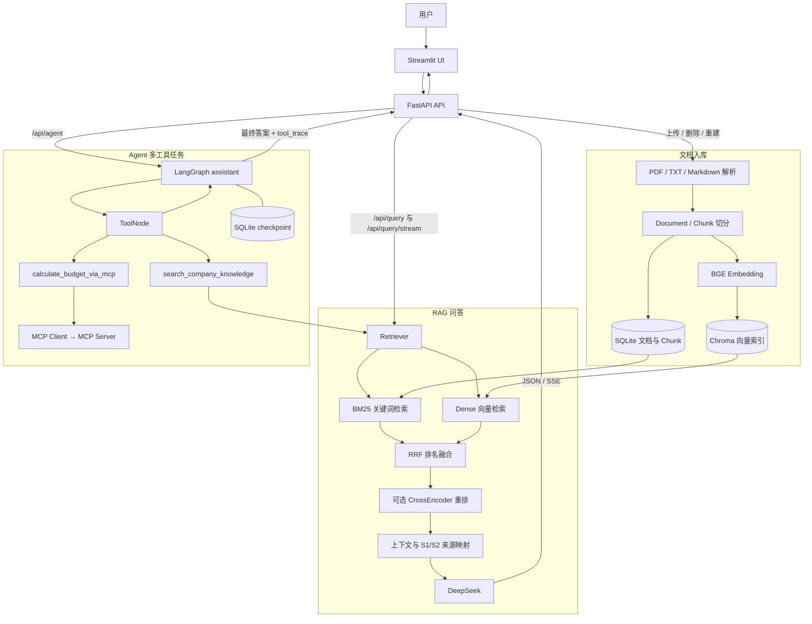

# 企业知识库智能助手｜RAG Knowledge Base V2

基于 **FastAPI + BGE Embedding + Chroma + BM25/RRF + DeepSeek + LangGraph + MCP + Streamlit** 实现的企业知识库问答与多工具任务助手。

> **项目定位**：面向大模型应用开发岗位的个人工程实践与本地演示项目。使用**虚构企业制度**作为业务数据，重点展示文档入库、混合检索、证据引用、RAG 流式生成、Agent 工具编排和容器化部署。**不是已投产的多租户企业系统**，请勿上传真实企业机密。

## 目录

- [项目概览](#项目概览)
- [系统架构](#系统架构)
- [核心设计与实现](#核心设计与实现)
- [快速开始](#快速开始)
- [Docker Compose 部署](#docker-compose-部署)
- [API 接口](#api-接口)
- [测试与验证](#测试与验证)
- [项目结构](#项目结构)
- [安全边界与已知限制](#安全边界与已知限制)

## 项目概览

企业制度分散在多份文档中，普通的大模型对话既无法确保掌握特定公司的最新规定，也难以可靠说明答案来自哪份文件。本项目围绕这一场景实现两条互补的业务路径：

- **RAG 问答**：上传 PDF / TXT / Markdown 文档，自动切分和建立索引；问题经过 BM25、Dense 或混合检索后，向 DeepSeek 提供检索证据，返回回答及 `[S1]`、`[S2]` 等来源信息；支持 SSE 实时显示回答。
- **Agent 多工具任务**：基于 LangGraph 的 assistant → tools 循环，按需要先检索企业制度，再通过 MCP 计算住宿预算；使用 SQLite checkpoint 按 `thread_id` 保存多轮对话状态，并在页面展示工具调用轨迹。

| 能力 | 关键实现 | 说明 |
| --- | --- | --- |
| 文档管理 | FastAPI、PyPDF、SQLite | 上传、SHA-256 内容去重、文档列表、删除、索引重建入口 |
| 文档切分 | `Document`、`split_document` | 复用原版字符窗口切分器，保留文档来源和字符区间 |
| 语义向量 | `BAAI/bge-small-zh-v1.5`、Sentence Transformers | 真实模式使用 BGE；测试模式可用非语义的 HashEmbeddings |
| 向量存储 | Chroma / SQLite 向量索引 | Chroma 持久化；SQLite 线性扫描后端仅用于离线演示和测试 |
| 检索与融合 | BM25、Dense、RRF | 支持 `bm25` / `dense` / `hybrid`，并预留 CrossEncoder 重排开关 |
| 答案生成 | DeepSeek、OpenAI 兼容接口 | 基于检索上下文回答并提供候选来源，普通 JSON 和 SSE 两种方式 |
| Agent | LangGraph、LangChain Tools | 模型决定工具调用；循环执行直至产生最终回答 |
| MCP | MCP Client / MCP Server、Decimal | 检索费率后计算住宿预算；不自行推断企业政策 |
| 应用交互 | Streamlit | 中文界面、文档上传、检索策略选择、问答、工具轨迹 |
| 工程化 | Dockerfile、Docker Compose、pytest、GitHub Actions | API 与 UI 分服务运行、数据卷持久化、离线测试工作流 |

## 系统架构



> 图中的 CrossEncoder 仅在 `RERANK_ENABLED=true` 时参与处理；默认关闭。RAG 已实现 SSE，**Agent 接口当前返回完整结果，并不提供 token 级流式输出**。

## 核心设计与实现

### 1. 文档入库与持久化

`POST /api/documents` → `enterprise.ingest.IngestionService.upload()`：

1. 检查扩展名、文件大小与文本提取结果；接受 `.pdf`、`.txt`、`.md`、`.markdown`，PDF 最多 200 页，不支持扫描件 OCR。
2. 标准化文本，使用 SHA-256 文本哈希识别重复内容；通过 UUID 生成文档 ID。
3. 调用项目原有的 `document.py` / `text_splitter.py` 进行字符级 Chunk 切分，保存 `filename`、`chunk_index`、`start_char`、`end_char`。
4. 使用配置的嵌入模型生成向量，将文档与 Chunk 元数据写入 SQLite，再将向量写入 Chroma（或测试用 SQLite 向量索引）。
5. 向量写入异常时尝试回滚 SQLite 中的文档记录；删除流程会清理向量与登记记录。

SQLite 与 Chroma 是两个独立存储，**不存在跨库原子事务**。`/api/admin/rebuild` 会依据 SQLite 中的 Chunk 再次写入向量索引，但不是彻底清空所有遗留向量的修复工具。

### 2. 检索策略与引用来源

`enterprise/retrieval.py` 支持三种模式：

- `bm25`：通过词项频率与文档频率计算关键词相关性，适合具体术语、名称和数字表达。
- `dense`：将查询编码为语义向量后查询向量索引，适合语义相似而措辞不同的表达。
- `hybrid`：分别召回 BM25 与 Dense 候选，通过 **RRF（Reciprocal Rank Fusion）按排名**合并，避免直接相加不同检索器的原始分数。

检索器先生成候选池，再选取 `top_k`（1～20）条结果；可通过 `RERANK_ENABLED` 启用 CrossEncoder 对候选进行重排序。来源信息在 `enterprise/rag.py` 中组织为 `[S1]`、`[S2]`，关联文件名、Chunk 编号、字符范围和文本预览。**引用标记是候选证据映射，不代表已完成逐句事实核验。**

### 3. RAG 回答与 SSE 流式传输

`RAGService` 先检索，再组装带来源标记的上下文，最后由 `enterprise/llm.py` 调用 DeepSeek。提示词要求优先依据资料回答、证据不足时说明不确定，并将检索文本视为不可信数据。

`POST /api/query` 返回完整 JSON；`POST /api/query/stream` 使用 `text/event-stream`，按以下事件发送：

```text
event: sources
data: [{"source_id":"S1", ...}]

event: token
data: "回答文本片段"

event: done
data: {}
```

生成失败时流中会出现 `event: error`。Streamlit 使用 `requests` 读取事件并通过 `st.write_stream` 增量显示；可在页面展开查看检索来源。

### 4. LangGraph Agent 与 MCP 工具调用

`enterprise/agent.py` 使用 `StateGraph(MessagesState)`、`ToolNode`、`tools_condition` 实现 assistant / tools 状态循环，集成以下工具：

- `search_company_knowledge`：调用现有 Retriever，为制度或费率问题获取知识库证据。
- `calculate_budget_via_mcp`：借助 MCP Client 调用 `enterprise/mcp_business.py` 提供的 `calculate_lodging_budget` 工具，按已查证的每晚费率与晚数计算预算。
- `current_date`：返回运行环境的当前日期。

MCP Server 另外定义了 `calculate_reimbursement_gap`（比较实际费用与允许额度），但当前 LangGraph Agent **尚未将其绑定为可选工具**。金额使用 `Decimal` 计算，避免一般浮点误差；**计算工具不负责认定报销资格或制定政策**。

Agent 使用 `thread_id` 和 `AsyncSqliteSaver` 保存会话 checkpoint；API 返回 `answer`、`thread_id`、`tool_trace`。真实 Agent 要求 `LLM_BACKEND=deepseek` 且提供有效的 API Key，Mock 模式不模拟 Agent 推理。

## 快速开始

建议使用 **Python 3.11**。以下命令在仓库根目录执行；完整模式需要网络连接、足够的模型缓存空间和有效 DeepSeek API Key。

### 1. 安装依赖

Windows PowerShell：

```powershell
py -3.11 -m venv .venv
.\.venv\Scripts\Activate.ps1
python -m pip install -r requirements-v2.txt
Copy-Item .env.example .env   # 仅首次创建；已有 .env 时不要覆盖
```

Ubuntu / Linux：

```bash
python3.11 -m venv .venv
source .venv/bin/activate
python -m pip install -r requirements-v2.txt
cp .env.example .env           # 仅首次创建；已有 .env 时不要覆盖
```

### 2. 配置环境变量

本项目通过 `enterprise/config.py` 从 `.env` / 环境变量读取配置。**不要将真实 API Key、Token 或数据库上传 GitHub。**

| 配置 | 作用 / 默认行为 |
| --- | --- |
| `DEMO_MODE` | `true` 时为未指定的后端选择离线默认值；`false` 为完整模式的默认组合 |
| `EMBEDDING_BACKEND` | `hash`（非语义演示）或 `bge` |
| `VECTOR_BACKEND` | `sqlite`（演示）或 `chroma` |
| `LLM_BACKEND` | `mock`（不调用模型）或 `deepseek` |
| `EMBEDDING_MODEL` | 默认 `BAAI/bge-small-zh-v1.5` |
| `DEEPSEEK_API_KEY` | 真实 DeepSeek 调用所需密钥 |
| `DEEPSEEK_MODEL` | 默认 `deepseek-chat` |
| `DEEPSEEK_BASE_URL` | 默认 `https://api.deepseek.com` |
| `APP_API_TOKEN` | 可选 Bearer Token；若留空，则 `/api/*` 不做该项鉴权 |
| `APP_DATA_DIR` | 数据库、索引与 checkpoint 存储目录 |
| `MODEL_CACHE_DIR` | 模型权重缓存目录 |
| `CHUNK_SIZE` / `CHUNK_OVERLAP` | 默认 450 / 60（字符） |
| `TOP_K` | 默认 5；接口允许范围 1～20 |
| `MAX_UPLOAD_MB` | 默认后端上传上限 8 MB |
| `RERANK_ENABLED` | 默认 `false` |
| `MAX_AGENT_STEPS` | Agent 图递归限制，默认 12 |

**离线调试配置**（显式配置三个后端，以免已有 `.env` 的真实模式设置覆盖 `DEMO_MODE`）：

```dotenv
DEMO_MODE=true
EMBEDDING_BACKEND=hash
VECTOR_BACKEND=sqlite
LLM_BACKEND=mock
APP_DATA_DIR=./.local_data_demo
APP_API_TOKEN=local-demo-token
```

**真实 RAG / Agent 配置**（示例，密钥请自行填写并妥善保管）：

```dotenv
DEMO_MODE=false
EMBEDDING_BACKEND=bge
VECTOR_BACKEND=chroma
LLM_BACKEND=deepseek
EMBEDDING_MODEL=BAAI/bge-small-zh-v1.5
DEEPSEEK_MODEL=deepseek-chat
DEEPSEEK_API_KEY=请填入自己的密钥
APP_API_TOKEN=请替换为足够长的随机令牌
APP_DATA_DIR=./.local_data_real
MODEL_CACHE_DIR=./.local_data_real/models
RERANK_ENABLED=false
```

**切换 Hash / BGE 或 SQLite / Chroma 时，请使用不同的数据目录并重新导入文档**，避免不同向量空间、后端数据混用。首次运行 BGE 需要模型下载及较充足磁盘空间。Streamlit 的上传控件可能显示框架自身的 200 MB 提示，实际限制以 `MAX_UPLOAD_MB` 的后端校验为准。

### 3. 启动 API 与 Web UI

第一个终端：

```bash
uvicorn enterprise.api:app --host 127.0.0.1 --port 8000
```

第二个终端（激活相同的 Python 环境）：

```bash
streamlit run ui/app.py
```

- Web UI：<http://127.0.0.1:8501>
- Swagger 接口文档：<http://127.0.0.1:8000/docs>
- 健康检查：<http://127.0.0.1:8000/health>

可在 UI 上传 `sample_company/` 中的虚构公司制度文件，也可以使用命令批量导入：

```bash
python -m scripts.import_samples
```

### 4. 演示建议

在上传 `sample_company/travel_policy.md` 后，可依次尝试：

1. **RAG**：「普通员工去上海出差的住宿标准是多少？需要哪些报销材料？」——观察 SSE 增量回答和引用来源。
2. **检索策略对比**：分别选择 `bm25`、`dense`、`hybrid`，比较候选来源，不预设混合检索一定更好。
3. **Agent（真实模式）**：「先查公司制度，再计算普通员工在上海出差 3 晚的住宿上限，附上依据。」——查看知识库检索与 MCP 预算工具轨迹。
4. **多轮 Agent**：用同一 `thread_id` 追问，再创建新会话对比上下文。示例制度记载上海普通员工 **400 元/晚**，3 晚数学结果为 **1200.00 元**；仅是虚构演示政策。

## Docker Compose 部署

仓库提供 `Dockerfile.v2` 和 `docker-compose.v2.yml`，将 **API、UI 分为两个容器服务**；UI 在 Compose 网络中使用 `http://api:8000` 调用后端。文档、索引和模型缓存使用 `model_data` 命名卷持久化。

```bash
# 在准备好 .env 后，从仓库根目录执行
docker compose -f docker-compose.v2.yml build
docker compose -f docker-compose.v2.yml up -d
docker compose -f docker-compose.v2.yml ps
docker compose -f docker-compose.v2.yml logs --tail=80 api
docker compose -f docker-compose.v2.yml logs --tail=80 ui
```

Compose 默认只将宿主机的 `127.0.0.1:8000` 和 `127.0.0.1:8501` 映射到容器。如果服务运行在 Ubuntu 虚拟机中，可按需使用 SSH 端口转发到本机访问，不应为了演示而直接暴露公网端口。

**关于 GPU 与镜像体积**：当前 Dockerfile 基于 `python:3.11-slim`，依赖中包含 Sentence Transformers / PyTorch 相关包，但 Compose **没有显式声明 GPU 设备申请**；GPU 是否可用取决于宿主机驱动、容器运行时和实际设备配置，不能仅凭“已安装 CUDA 依赖”认定使用了 GPU。构建大型依赖层需要足够磁盘空间；如遇 `no space left on device`，先检查宿主机空间与 Docker 占用。

**重要：**更新代码后需要重新构建镜像并重建容器；`docker cp` 修改正在运行的容器不会更新镜像。不要为了清理旧环境随意执行 `docker compose down -v` 或删除 `model_data`，否则可能丢失持久化数据。GitHub 源码仓库只需要提交 Dockerfile / Compose 等构建配置，镜像如需发布可另用 GHCR / Docker Hub。

## API 接口

业务接口使用可选的 `Authorization: Bearer <APP_API_TOKEN>`。当 `APP_API_TOKEN` 未设置时，该共享令牌鉴权不会生效；`/health` 不受该鉴权保护。

| 方法 | 路径 | 功能 |
| --- | --- | --- |
| `GET` | `/health` | 运行状态与当前后端信息 |
| `GET` | `/api/documents` | 获取已索引文档列表 |
| `POST` | `/api/documents` | 以 `multipart/form-data` 的 `file` 字段上传并索引文档 |
| `DELETE` | `/api/documents/{doc_id}` | 删除指定文档及其索引 |
| `POST` | `/api/admin/rebuild` | 根据已保存 Chunk 再次写入向量索引 |
| `POST` | `/api/search` | 返回检索候选，不调用 LLM |
| `POST` | `/api/query` | 生成完整 RAG 回答和来源 |
| `POST` | `/api/query/stream` | SSE：`sources`、`token`、`done` / `error` |
| `POST` | `/api/agent` | Agent 完整回答与工具轨迹（非流式） |

RAG 请求：

```json
{
  "query": "普通员工上海出差住宿上限是多少？",
  "top_k": 5,
  "strategy": "hybrid"
}
```

Agent 请求：

```json
{
  "question": "先查制度，再计算普通员工在上海出差3晚的住宿上限，给出来源。",
  "thread_id": "demo-session-001"
}
```

两类请求由 Pydantic 验证。`query` / `question` 最长 2000 字符，`top_k` 取值 1～20，`strategy` 仅允许 `hybrid` / `dense` / `bm25`，`thread_id` 仅允许 1～64 位字母、数字、下划线与连字符。

## 测试与验证

### 离线测试

```bash
# 建议先在 .env 中选择离线配置以及独立的 APP_DATA_DIR
python -m pytest -q tests_v2
python -m pytest -q tests/test_loaders.py tests/test_text_splitter.py
python -m scripts.smoke_demo
```

本次依据上传的源码，在**隔离的数据目录和显式 mock/hash/sqlite 后端**下实际执行的结果：

| 测试 | 本次结果 | 覆盖范围 |
| --- | --- | --- |
| `compileall` | 通过 | V2 核心 Python 文件语法 |
| `tests_v2` | **8 passed, 1 skipped** | API 鉴权 / 校验、上传、去重、删除、RAG 来源、BM25/RRF 等；因本次环境缺少 MCP SDK，MCP 用例跳过 |
| 原版 `test_loaders.py` + `test_text_splitter.py` | **23 passed** | 旧版文档读取与文本切分 |
| `scripts.smoke_demo` | 通过 | 离线导入示例制度并返回来源与 mock 回答 |
| `/api/query/stream` 本地接口调用 | 通过 | SSE 返回 `sources`、`token`、`done` 事件 |

**未在此次检查环境完整复验**：真实 BGE 模型加载、Chroma 后端、DeepSeek 在线回答、LangGraph 多轮 checkpoint、MCP Client/Server 回环、完整 Streamlit 联调、正式 Docker GPU 镜像构建。此前本地/Ubuntu 演示曾进行过 RAG、中文 UI 和 Agent 工具调用测试，但**注释整理后的最终镜像尚需重新构建并做端到端验收**。

### 检索评测

```bash
python -m scripts.import_samples
python -m evaluation.run_eval
```

`evaluation/run_eval.py` 对 `evaluation/questions.json` 中的预设问题计算 **Hit@5** 与 **MRR@5**，比较 `dense` / `bm25` / `hybrid`。当前示例数据仅有 **8 份虚构制度、23 道评测问题**；离线 HashEmbeddings 数据规模过小且不具备语义表示能力，因此不将示例结果当成真实检索提升或生产性能证据。需要真实评测时应使用 BGE + Chroma，并报告测试集、指标、硬件和运行配置。

## 项目结构

```text
rag-knowledge-base/
├─ enterprise/                # V2 后端核心
│  ├─ api.py                  # FastAPI 路由、鉴权、Pydantic、SSE
│  ├─ service.py              # 依赖装配与服务生命周期
│  ├─ config.py               # 环境变量与配置检查
│  ├─ ingest.py               # 文档上传、解析、去重和索引
│  ├─ legacy_bridge.py        # 复用原版 Document / split_document
│  ├─ embedding.py            # BGE 与 HashEmbeddings
│  ├─ storage.py              # SQLite 文档和 Chunk 数据
│  ├─ vector_index.py         # Chroma / SQLite 向量索引
│  ├─ retrieval.py            # BM25 / Dense / RRF / 可选重排
│  ├─ rag.py                  # 检索证据组织与来源映射
│  ├─ llm.py                  # DeepSeek / mock 生成与流式接口
│  ├─ agent.py                # LangGraph Agent 与工具调用
│  └─ mcp_business.py         # MCP 预算计算工具服务
├─ ui/app.py                  # Streamlit 中文界面
├─ sample_company/           # 虚构企业制度文档
├─ scripts/                  # 示例导入与离线烟雾测试
├─ evaluation/               # 检索评测题集和脚本
├─ tests/                    # 原版 RAG 基础测试
├─ tests_v2/                 # V2 API、入库与 MCP 测试
├─ docs/                     # 学习、联调与面试参考资料
├─ .github/workflows/        # V2 离线测试工作流
├─ document.py               # 原版 Document 数据结构
├─ text_splitter.py          # 原版 Chunk 切分器
├─ Dockerfile.v2
├─ docker-compose.v2.yml
├─ requirements-v2.txt
└─ .env.example               # 配置示例，非真实密钥
```

根目录的 `main.py`、`loaders.py`、`embeddings.py`、`retriever.py` 等为原版学习实现；V2 通过 `legacy_bridge.py` 复用其中的 Document / Chunk 能力，其余旧代码主要用于保留学习历史和基础测试。

## 安全边界与已知限制

- **单用户演示**：仅提供可选共享 Bearer Token；没有 SSO、RBAC、租户隔离、细粒度文档权限或完整审计。Token 留空会关闭该项鉴权。
- **文档解析限制**：PDF 只处理可提取文本；不支持 OCR、复杂表格布局重建等能力。
- **检索限制**：BM25 当前基于简单中英文 token 处理；检索在 SQLite 中读取全部 Chunk，尚未针对海量文档做大规模优化。
- **一致性限制**：SQLite 和 Chroma 无跨库事务；向量写入与删除异常需要运维检查，单纯执行 rebuild 不一定能清除孤立向量。
- **回答可靠性**：提示词与来源展示可以辅助核验，但无法完全阻止幻觉、恶意文档提示注入或引用错误。
- **Agent 与 MCP 限制**：工具由模型选择，不能保证每次工具调用顺序都符合预期；预算工具仅进行计算，不代替真实财务审批。MCP 为进程内 Client/Server 调用，不是已部署的远程 MCP 服务。
- **部署限制**：尚未实现公网生产环境所需的并发压测、限流、安全审计、监控告警、备份恢复和 GPU 自动设备申请配置。

## 项目说明

本仓库用于展示从基础 RAG（Document、Chunk、Embedding、Top-K）到可交互知识库与 Agent 的工程演进。业务规则及演示数据均为虚构样例；项目中的技术选择和功能验证以代码、可复现测试及实际部署记录为准，不宣称未经测量的性能提升。
